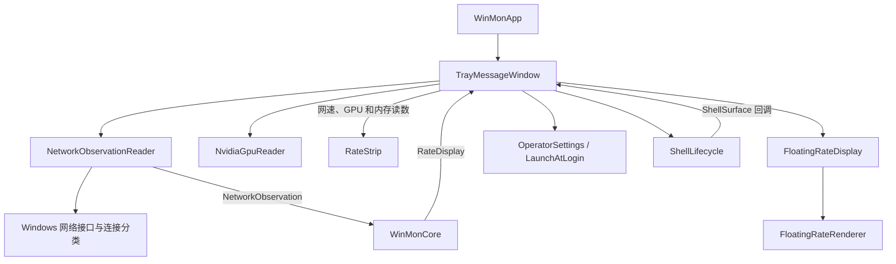

# Win Mon 技术架构

本文面向维护者，说明当前代码的模块边界与运行流程。日常使用见[使用说明](../README.md)。领域术语以 [CONTEXT.md](../CONTEXT.md) 为准。设计决策记录在 [docs/adr](adr/)。

## 术语

- **消息宿主**：隐藏顶层窗口 `TrayMessageWindow`，负责消息循环、定时器和生命周期协调。
- **任务栏读数**：嵌入主显示器底部 `Shell_TrayWnd` 的子窗口 `RateStrip`。
- **悬浮窗**：独立于任务栏的置顶分层窗口 `FloatingRateDisplay`。
- **托盘图标**：通知区域中的 Win Mon 图标。
- **右键菜单**：用户从托盘图标、任务栏读数或悬浮窗打开的原生菜单。

## 总体结构

Win Mon 使用 C++20、Win32 和 MFC。程序只有一个进程。程序没有可见的主窗口。MFC 只负责应用入口、窗口消息和原生菜单。Win Mon 不使用文档与视图框架。

CMake 定义两个产品目标：

| 目标 | 职责 | 边界 |
| --- | --- | --- |
| `WinMonCore` | 计算网络速率、选择网络和生成菜单模型；执行设置事务并制定恢复策略 | 静态库。不依赖 MFC 或窗口句柄。 |
| `WinMon` | 读取 Windows 数据、管理窗口和绘制画面；保存设置并执行菜单动作 | Windows 可执行程序。调用 `WinMonCore`。 |

下图表示运行时的主要调用与数据流。此图不表示全部编译依赖。



## 模块与源码入口

| 模块 | 职责 | 源码入口 |
| --- | --- | --- |
| 应用入口 | 创建单实例互斥量，启动消息宿主，退出时释放资源 | [WinMonApp.cpp](../src/WinMon/app/WinMonApp.cpp) |
| 消息宿主 | 持有核心对象与显示对象；触发采样、打开菜单并响应系统广播 | [TrayMessageWindow.cpp](../src/WinMon/app/TrayMessageWindow.cpp) |
| 核心逻辑 | 计算速率，维护网络选择，生成菜单模型，检查入口状态 | [WinMonCore.cpp](../src/WinMonCore/WinMonCore.cpp) |
| 网络读取 | 读取系统计数器，缓存经典「网络连接」分类，生成网络快照 | [NetworkObservationReader.cpp](../src/WinMon/platform/NetworkObservationReader.cpp) |
| GPU 读取 | 从系统目录加载 `nvapi64.dll`，选择首块同时提供占用率和核心温度的显卡 | [NvidiaGpuReader.cpp](../src/WinMon/platform/NvidiaGpuReader.cpp) |
| 任务栏读数 | 嵌入主任务栏，检查空闲区域，绘制启用组，响应主题和 DPI 变化 | [RateStrip.cpp](../src/WinMon/taskbar/RateStrip.cpp) |
| 悬浮窗宿主 | 管理本体窗口与阴影窗口；响应拖动与双击，保存位置并控制动画定时器 | [FloatingRateDisplay.cpp](../src/WinMon/floating/FloatingRateDisplay.cpp) |
| 悬浮窗渲染 | 管理采样历史、圆环与水波；绘制曲线、读数并复用绘制资源 | [FloatingRateRenderer.cpp](../src/WinMon/floating/FloatingRateRenderer.cpp) |
| 显示设置 | 读取和保存当前用户的显示偏好与悬浮窗位置 | [OperatorSettings.cpp](../src/WinMon/settings/OperatorSettings.cpp) |
| 登录启动 | 管理当前用户的 Windows 登录启动项 | [LaunchAtLogin.cpp](../src/WinMon/platform/LaunchAtLogin.cpp) |

## 采样与数据流

消息宿主的一秒定时器触发采样。窗口消息驱动采样、菜单动作和恢复流程。

1. `NetworkObservationReader::Read()` 调用 `GetIfTable2`，读取累计收发字节数。
2. 读取器附加连接状态、硬件标记和连接分类，生成 `NetworkObservation`。
3. `WinMonCore::ObserveNetwork()` 接收快照与采样时间。
4. `WinMonCore::Sample()` 用相邻快照的字节差除以实际时间差，得出速率。
5. 消息宿主把同一次采样结果送到任务栏读数和悬浮窗。
6. 监控网络切换时，消息宿主重置悬浮窗的图形历史。

任务栏读数开启时，消息宿主在同一定时器中按勾选项读取内存和 GPU。内存调用 `GlobalMemoryStatusEx`。GPU 调用 `NvidiaGpuReader::Read()`。读取失败的组用「--」代替数值。悬浮窗只使用网络采样。

速率单位按 1000 进位，分为「K/s」、「M/s」和「G/s」。首次采样没有前值，显示零速率。计数器回退时，对应方向不计算负速率。

网络选择遵守以下规则：

- 每次启动默认选择「All」。Win Mon 不保存所选网络。
- 「All」汇总已连接的硬件网络，排除回环接口。
- 连接分类有效时，「All」排除不在经典「网络连接」中的接口。
- 虚拟接口和隧道接口可以单独选择，但不参与「All」汇总。
- 所选接口断开时保留选择，显示零速率。所选接口从系统中消失时，恢复选择「All」。

采样和右键菜单共用同一个读取器。连接分类正常缓存 30 秒。查询失败时，读取器在 2 秒后重试。接口 GUID 集合变化时，读取器立即刷新分类。分类不可用时，菜单保留枚举到的全部非回环接口。

## 显示与动画

### 任务栏读数

`RateStrip` 把子窗口嵌入主显示器底部的 `Shell_TrayWnd`。`RateStrip` 不缩小任务列表，也不永久修改其他任务栏窗口。

- 「Right」定位在通知区域旁。「Left」检查任务栏左端的空闲区域。
- 任务栏不可用、布局不受支持或空间无法确认时，隐藏任务栏读数并保留位置偏好。
- 读数区高 36 DIP。宽度按启用组、组间距和总物理内存预留计算。
- 每次采样刷新布局和主题。系统通知也会触发更新。
- 任务栏右键菜单关闭时，鼠标点击穿透到任务栏。

### 悬浮窗

`FloatingRateDisplay` 管理置顶的分层本体窗口和独立阴影窗口。阴影窗口不接收鼠标输入。拖动窗口不激活焦点。悬浮窗与托盘图标共用同一套右键菜单逻辑。

`FloatingRateRenderer` 使用 Direct2D 软件渲染。任务栏读数和悬浮窗共用内置 Punctum LED 字形。使用内置字形不必在系统中安装字体。读数超出三位整数容量时，在当前单位下显示为「999.9」。

悬浮窗的一秒采样与约 30 FPS 动画分开运行。动画定时器负责水波、曲线滚动和可见性过渡，不生成流量样本。悬浮窗关闭或空闲动画结束时，停止动画定时器。Windows 动画关闭时，渲染器直接使用静态结果。

渲染器复用路径、画刷和像素缓冲。采样历史或 DPI 变化时，渲染器更新对应资源。悬浮窗关闭时，释放窗口与渲染资源。

## 菜单与设置

`WinMonCore` 生成 `OperatorMenuItem` 模型。消息宿主把模型转换为原生 `CMenu`。用户完成菜单选择后，`WinMonCore` 返回 `OperatorAction`。消息宿主执行对应的 Windows 操作。菜单构造失败或提前退出时，作用域对象取消核心中的菜单状态。

显示偏好保存在 `HKEY_CURRENT_USER\Software\Win Mon`。登录启动单独使用当前用户 `Run` 项，指向当前可执行文件。监控网络选择和双击循环方向只保存在内存中。

任务栏显示内容分别保存为以下三个 DWORD：

- `TaskbarRatesVisible`
- `TaskbarGpuVisible`
- `TaskbarMemoryVisible`

切换内容时，先保存设置，保存成功后再更新显示。启动时没有可显示的组，则本次启用网速并保留已保存的选择。

多数显示设置通过 `OperatorSettingTransaction::Commit()` 修改：

1. 应用新的运行状态。
2. 保存设置。
3. 应用失败或保存失败时，尝试恢复原运行状态。

事务返回以下四种结果之一：

- 应用成功
- 应用失败
- 回滚成功
- 需要恢复

调用方按结果执行恢复。例如任务栏位置回滚失败时，重建显示并读取已保存的值。登录启动和位置保存使用各自的保存路径，不经过该事务。

程序在生成菜单和执行动作时检查菜单入口。任务栏入口只有在任务栏读数实际显示且右键菜单开启时才有效。程序不得关闭最后一个可用入口。

## 生命周期与故障恢复

- **启动**：`WinMonApp` 创建命名互斥量。重复启动时，新进程直接退出。消息宿主读取设置，先建立托盘入口，再恢复任务栏读数和悬浮窗。
- **启动失败**：单实例互斥量或消息宿主初始化失败时，显示错误并退出。初始化包含建立托盘入口和采样定时器。
- **Explorer 重启**：隐藏的顶层窗口接收 `TaskbarCreated` 广播。消息宿主调用 `ShellLifecycle` 恢复托盘图标和任务栏读数。消息专用窗口不能接收广播，因此不用于此处。
- **恢复重试**：恢复失败时，消息宿主启动两秒重试定时器。采样状态和当前网络选择留在进程内。
- **菜单入口丢失**：布局变化导致其他入口不可用时，临时恢复托盘图标。此操作不覆盖用户保存的托盘偏好。
- **无效启动配置**：保存的配置关闭所有入口时，启动逻辑开启托盘图标和悬浮窗。之后启动逻辑尝试保存恢复后的设置。
- **退出**：停止定时器，销毁显示窗口，移除托盘图标，释放单实例互斥量。

系统边界与取舍见以下 ADR：

- [任务栏嵌入](adr/0001-taskbar-rate-strip-embed.md)
- [支持范围](adr/0002-win11-primary-bottom-only.md)
- [MFC 使用边界](adr/0003-mfc-tray-app.md)
- [设置保存](adr/0007-registry-persisted-operator-settings.md)
- [悬浮窗](adr/0008-floating-rate-display.md)

程序以普通用户权限运行。程序不协调其他软件嵌入任务栏时的区域冲突。

## 构建与验证

构建环境必须具备以下工具：

- Visual Studio C++ 桌面开发工具
- MFC
- Windows SDK
- CMake 3.25 或更高版本

在 Visual Studio 开发者 PowerShell 中执行以下命令：

```powershell
cmake -S . -B build -A x64
cmake --build build --config Release
ctest --test-dir build -C Release --output-on-failure
```

程序输出文件为 `build/Release/WinMon.exe`。所有配置、编译和测试都必须通过 CMake 执行。

| CTest 标签 | 检查范围 |
| --- | --- |
| `unit` | 核心速率、网络选择、菜单模型、设置事务和恢复策略；注入的网络读取、动画状态和读数解析。 |
| `integration` | 隔离注册表、拒绝写入、登录启动项、离屏渲染和原生悬浮窗行为。 |
| `acceptance` | 显式开启的真实桌面验收：单实例、正常退出、Shell 恢复和菜单；宿主设置回滚和任务栏输入。 |

Catch2 把每个行为用例独立注册到 CTest。默认只运行单元与集成测试。截图生成单独使用 `visual-evidence` 目标。

相关指南如下：

- 测试分层与新增用例规则见[测试指南](../tests/README.md)。
- 具体目标与链接依赖见 [tests/CMakeLists.txt](../tests/CMakeLists.txt)。
- 多显示器环境和鼠标拖动手感必须人工验证，自动化测试无法替代。

[tests.yml](../.github/workflows/tests.yml) 在拉取请求和 main 分支更新时验证 Debug 与 Release 构建。

发布工作流见 [release.yml](../.github/workflows/release.yml)。该工作流读取资源文件中的版本号。之后工作流执行构建与测试，打包程序、运行库和字体许可，并发布到对应的 GitHub Release。
